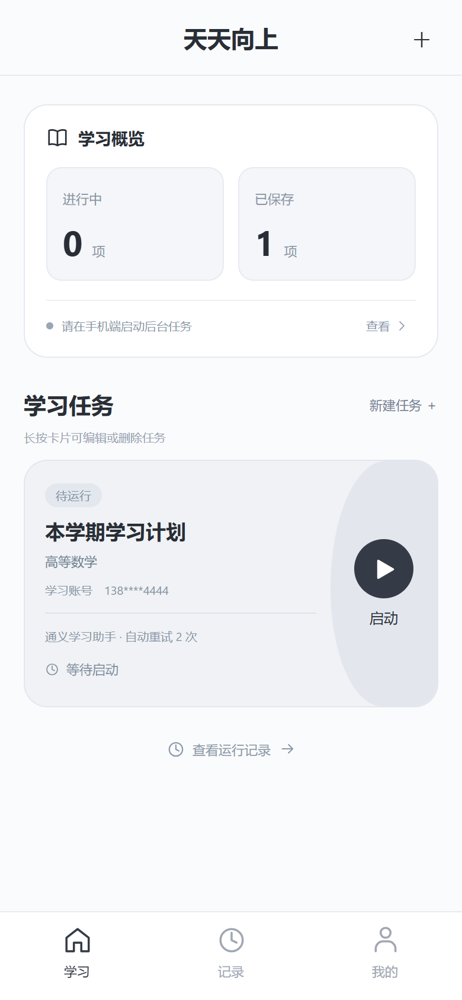
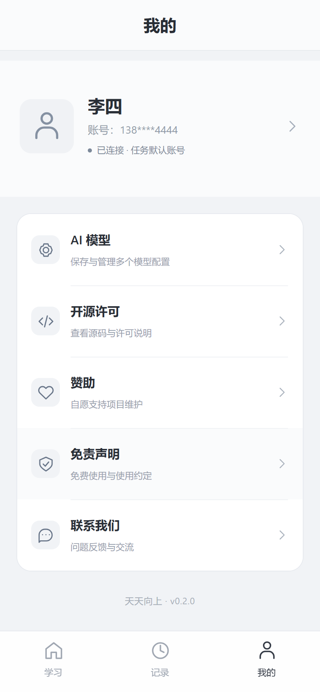
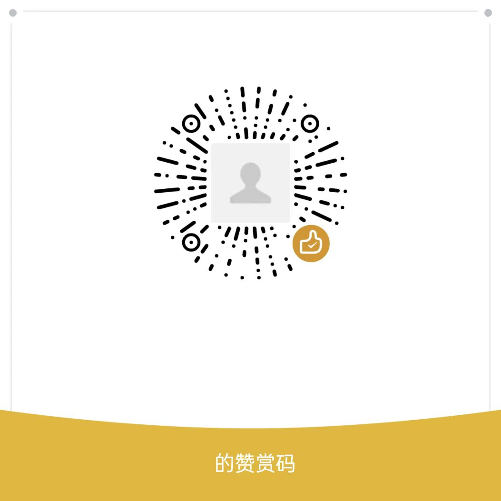

# 天天向上

基于 Vue 3、TypeScript、Element Plus 和 Go 的学习通课程助手，提供电脑本地预览与 Android 客户端。

支持多账号管理、课程读取、AI 模型配置、任务管理和运行记录。Android 内嵌 Python 3.12 与 SuperStar 核心，任务在手机本地前台服务中运行，无需电脑或云端代为执行；平台登录与 AI 调用仍需联网。

## 功能与进度

| 功能 | 当前状态 |
| --- | --- |
| 账号管理 | 账号密码登录、读取平台姓名、多账号切换与默认账号、本机加密保存 |
| 课程读取 | 按所选账号读取真实课程，支持多选课程或手动输入 ID |
| AI 模型 | 多配置、主模型与备用模型、模型列表获取、实际调用测试 |
| 接口格式 | 支持 Chat Completions、Responses、Anthropic Messages |
| 任务管理 | 分步新建、编辑、删除、参数校验、重启后恢复任务配置 |
| 手机执行 | Android 本地执行、前台通知、停止入口、进度与完成状态核验 |
| 运行记录 | 展示最新进度，保留最近 500 条内存记录 |
| 关于页面 | 项目仓库、赞助、使用说明和联系方式 |

当前版本仍在开发中。电脑端用于界面预览及配置管理，任务执行需要 Android 客户端。完整课程、长时间后台运行及不同手机的省电策略仍需持续实机验收；系统强行停止或设备重启后，需要手动再次启动任务，按平台已保存进度继续。

## 界面预览

以下为使用模拟账号与任务的界面截图，不代表真实账号或学习记录。

<p>
  
  
</p>

## 本地运行

需要 Node.js 22+、npm 10+ 和 Go 1.23+。在项目根目录执行：

```sh
npm ci
npm run build:desktop
npm start
```

启动后访问[本机页面](http://127.0.0.1:18081/#my)。开发前端时，保持后端运行，另开终端执行 `npm run dev`，再打开终端打印的开发地址。

服务默认仅监听本机回环地址，端口通过 `TIANTIAN_PORT` 设置，前端开发代理默认连接 18081。账号、模型和任务配置经 AES-GCM 加密保存于 `data/settings.enc`，密钥为 `data/vault.key`。两者需要一起备份，**不要上传 `data/`，加密数据和对应密钥均不应进入公开仓库。**

首次使用时，在“我的”连接本人账号并添加 AI 模型配置，再在学习首页新建任务。详细交互、接口与运行限制见[使用说明](docs/usage.md)。

## Android 打包

现有 Android 构建脚本面向 Windows，需要 Node.js 22+、Go 1.23+、JDK 17、Python 3.12、Android SDK Platform 36、Build Tools 36.0.0、NDK 28.2.13676358 和 Gradle 8.13。脚本复用已有工具，不自动安装系统依赖；首次打包会获取 Gradle / Chaquopy 插件与 Python 依赖。

| 环境变量 | 用途 |
| --- | --- |
| `TIANTIAN_JAVA_HOME` / `JAVA_HOME` | JDK 目录 |
| `TIANTIAN_PYTHON` | Python 3.12 可执行文件；未设置时尝试本机用户安装目录或 `python` |
| `TIANTIAN_ANDROID_SDK` / `ANDROID_HOME` / `ANDROID_SDK_ROOT` | 含 SDK 36 与 NDK 的 SDK 目录 |
| `TIANTIAN_GRADLE` | `gradle.bat` 的完整路径，也可放入 PATH |
| `ANDROID_NDK_HOME` | 可选的独立 NDK 目录 |
| `TIANTIAN_NDK_VERSION` | 可选的 SDK 内 NDK 版本，默认 `28.2.13676358` |
| `TIANTIAN_ANDROID_REFERENCE_ROOT` | 可选的已有工具工程目录，其 `.workbench-local/` 含 SDK 和 Gradle |

工具准备好后，在项目根目录执行：

```sh
npm ci
npm run build
```

完整构建依次生成前端、电脑后端、Android 内嵌 Go 动态库和已签名的 debug APK，不自动安装到手机。版本号、应用名称和 Android versionCode 在根目录 `package.json` 中管理。

| 产物 | 位置 |
| --- | --- |
| 前端 | `dist/web/` |
| 电脑后端 | Windows：`dist/backend/tiantianxiangshang.exe`；其他系统无 `.exe` 后缀 |
| Android 安装包 | `release/Android/天天向上-0.2.0-debug.apk` |

APK 面向 Android 8.0+ 的 ARM64 手机。界面、Go 服务和 Python 执行器均在应用内运行，账号和密钥存放在 Android 应用私有目录，不包含电脑 `data/` 中的个人配置。当前使用 debug 签名，签名密钥保存在 `.cache/android-debug.keystore`，请留在本机，以便后续覆盖安装。

构建成功后会打印 `APK ready` 和绝对路径；如果构建失败，请勿将目录中已有的旧 APK 当作本次产物。已有依赖缓存时可尝试 `npm run build -- --offline`，该参数传给 Gradle，缺少缓存时仍可能失败。

## 常用命令

| 命令 | 作用 |
| --- | --- |
| `npm run dev` | 启动前端开发服务，代理本机 Go API |
| `npm start` | 运行已构建的电脑后端和前端 |
| `npm run check` | 前端类型检查、Go 测试与 vet |
| `npm run build` | 构建前端、电脑后端和 Android APK |
| `npm run build:desktop` | 构建前端和电脑后端，无需 Android 工具 |
| `npm run build:android` | 构建前端和 Android APK |
| `npm run build:web` | 仅构建前端 |
| `npm run export:github` | 生成 `release/github-upload/` 源码上传目录 |

构建命令不自动执行 `npm run check`，发布前请单独运行检查。界面回归脚本位于 `scripts/qa/`，使用本机 Edge；`navigation.cjs` 需要先启动本机服务，`tasks.cjs` 自行启动隔离服务。手机 Python 离线检查使用本机 `.cache/mobile-python-tests/` 中准备好的依赖，这些依赖不会随源码上传。

## 项目结构与来源

```text
frontend/src/                 页面、组件、状态与 API 调用
frontend/public/              应用静态资源、赞赏码与联系图片
backend/cmd/                  电脑服务与 Android 启动入口
backend/internal/             HTTP API、平台适配与加密存储
android/app/src/main/         Android 原生桥接、Python 执行器及资源
scripts/                      构建、启动、检查和源码导出
docs/                         使用说明、上传说明与界面预览
```

Android 的 SuperStar 核心来源及提交版本见 [UPSTREAM.md](android/app/src/main/python/UPSTREAM.md)，保留原作者注释；内置 pyaes 保留其 [MIT 许可](android/app/src/main/python/pyaes/LICENSE.txt)。学习通登录与课程读取代码参考全能工作台；界面、图标及赞助 / 联系图片参考和复用 panguai 项目。

项目仓库：[842720301wh-ship-it / xuexitong](https://github.com/842720301wh-ship-it/xuexitong)。使用、修改及分发时请保留已有第三方署名与许可说明。

## 使用说明

请仅使用本人账号，遵守平台规则与学校要求。软件免费提供，禁止售卖、付费分发或以激活、解锁功能等名义收费。遇到账号验证、任务状态或学习记录异常时，请在官方平台核对。

## 支持项目

如果项目对你有帮助，欢迎自愿打赏，支持后续维护。软件免费使用，打赏不解锁额外功能，也不影响现有功能使用。

<p align="center">
  
</p>

使用微信扫一扫，或保存图片后在微信中识别。

问题反馈请通过仓库 Issues，或加入 QQ 交流群：**345353411**。


